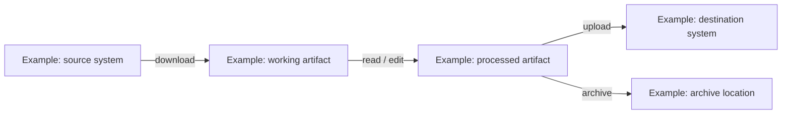

# File Journey

> Bot-owned context. Keep logical metadata only. Do not store file contents, credentials, tokens, or unnecessary sensitive data.

## Scope

- Process / workflow:
- Last reviewed:
- Owner:
- Detected capabilities: download / copy / read / edit / rename / archive / upload / delete (applicable values only)

## Artifact lifecycle

Document one row per logical artifact. Add failure, retry, quarantine, cleanup, retention, and deletion details when they apply.

| Artifact ID / name | Format / schema | Location / system | Lifecycle action | Producer | Consumer | Temporary / permanent | Success path | Failure / retry / quarantine / cleanup path | Retention / deletion |
| --- | --- | --- | --- | --- | --- | --- | --- | --- | --- |
|  |  |  |  |  |  |  |  |  |  |

## File journey diagram

Generate a Mermaid `flowchart LR` from the source-cross-checked artifact lifecycle table. Replace the illustrative graph below with verified logical artifacts, systems/locations, and processing steps; label edges with the applicable file actions. Use matching artifact IDs/names in the table and graph. Include failure, retry, quarantine, archive, cleanup, retention, and deletion branches only when implemented. Do not invent paths or behavior, include file contents or secrets, or leave example nodes in a completed journey. If no file handling exists, state that explicitly instead of generating a fictional graph.

## Cross-check

- Source workflows/configuration reviewed:
- Dependencies/resources reviewed:
- Mermaid syntax and table/diagram consistency checked:
- Output QA requirement and evidence:
- Last source cross-check: